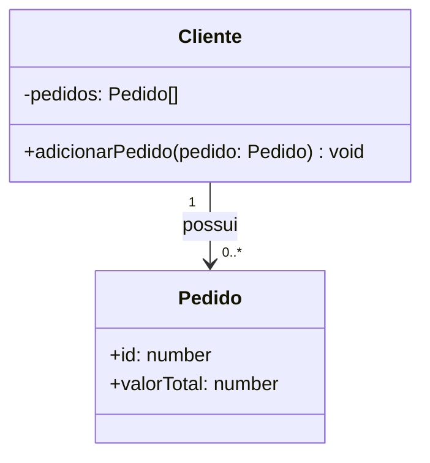
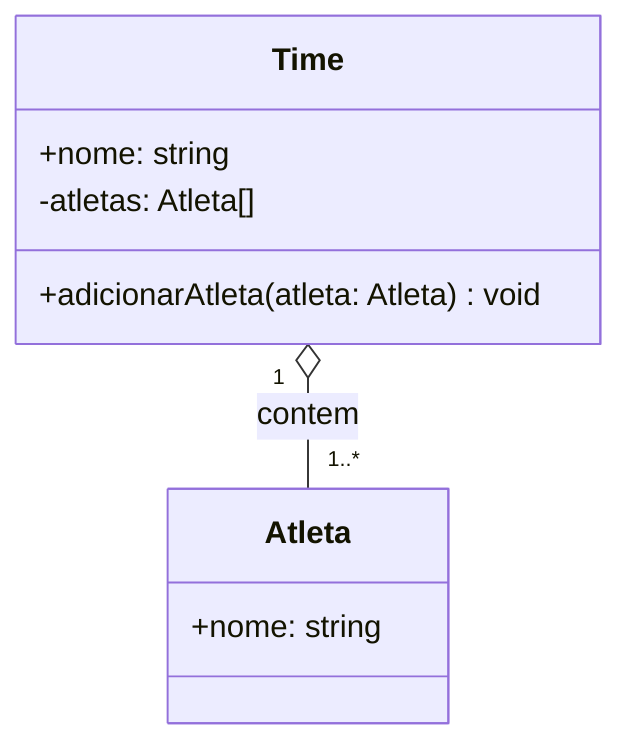
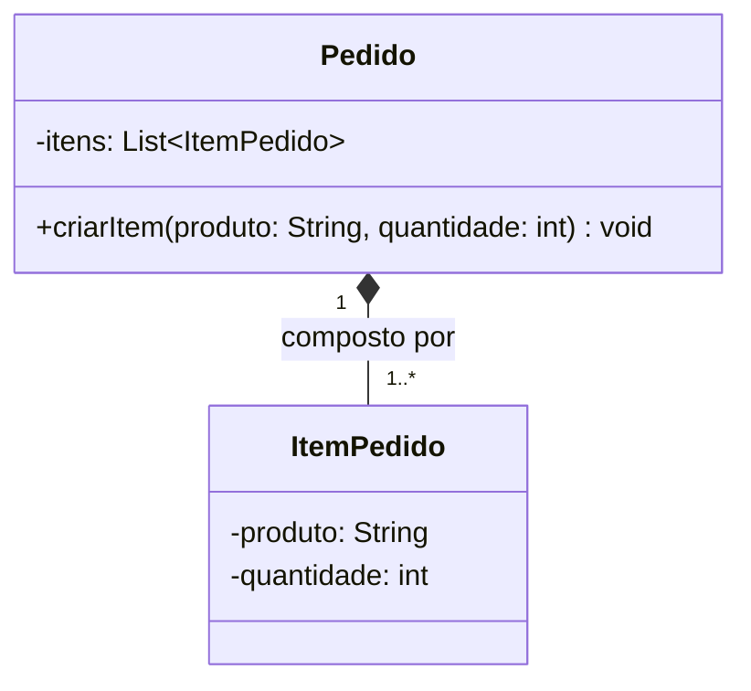
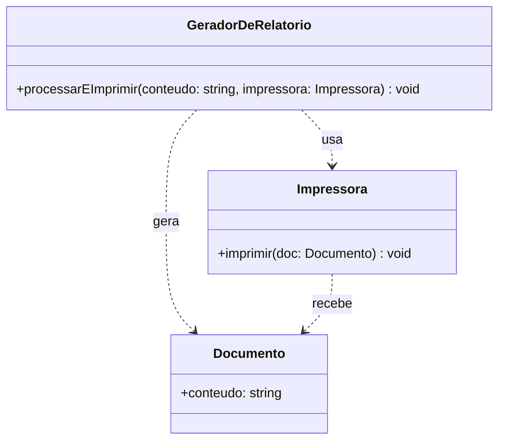
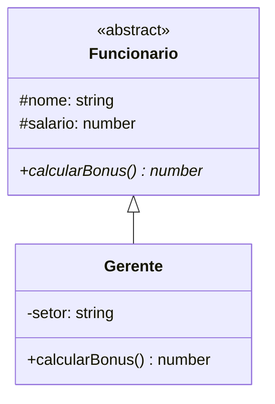
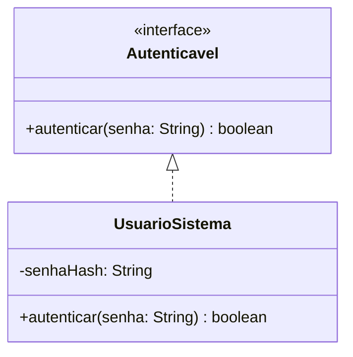

No Diagrama de Classes da UML, os relacionamentos especificam a estrutura estática, as conexões de memória e as dependências operacionais entre classificadores.

Abaixo estão os **7 principais tipos de associação e relacionamento**, acompanhados de sua notação e semântica UML, seus respectivos **diagramas em Mermaid** e os exemplos de código correspondentes em **TypeScript** e **Java**.

---

### 1. Associação Simples / Direcionada (*Association*)
* **Conceito:** Representa uma relação semântica estrutural entre duas classes, em que instâncias de uma classe mantêm referências ou links para instâncias de outra. A seta na extremidade indica a **navegabilidade** unidirecional.
* **Notação UML:** Linha contínua, opcionalmente finalizada com uma seta aberta na ponta navegável.
* **Exemplo de Domínio:** Um `Cliente` possui vários `Pedido`s.

#### Diagrama Mermaid:


#### Código (TypeScript):
```typescript
class Pedido {
  constructor(public id: number, public valorTotal: number) {}
}

class Cliente {
  private pedidos: Pedido[] = [];

  public adicionarPedido(pedido: Pedido): void {
    this.pedidos.push(pedido);
  }
}
```

---

### 2. Agregação (*Aggregation / Shareable Aggregation*)
* **Conceito:** É uma forma especializada de associação que representa um vínculo de **"todo-parte" fraco** (*shareable aggregate*). Os objetos "parte" possuem ciclo de vida **independente** do objeto "todo" e podem ser compartilhados entre diferentes agregados.
* **Notação UML:** Linha contínua com um **losango transparente/vazio** (`o--`) apontado para o lado do "todo".
* **Exemplo de Domínio:** Um `Time` possui vários `Atleta`s. Se o `Time` for extinto, os `Atleta`s continuam existindo no sistema.

#### Diagrama Mermaid:


#### Código (TypeScript):
```typescript
class Atleta {
  constructor(public nome: string) {}
}

class Time {
  constructor(public nome: string, private atletas: Atleta[]) {}

  public adicionarAtleta(atleta: Atleta): void {
    this.atletas.push(atleta);
  }
}
```

---

### 3. Composição (*Composition / Composite Aggregation*)
* **Conceito:** É uma forma forte de agregação (*owns/contains*) em que o objeto "todo" exerce **posse exclusiva** sobre as partes. O objeto "todo" é responsável pela criação, alocação de memória e destruição de suas partes.
* **Notação UML:** Linha contínua com um **losango preenchido/preto** (`*--`) no lado do "todo".
* **Exemplo de Domínio:** Um `Pedido` contém vários `ItemPedido`. Se o `Pedido` for destruído, seus `ItemPedido` associados deixam de existir.

#### Diagrama Mermaid:


#### Código (Java):
```java
import java.util.ArrayList;
import java.util.List;

class ItemPedido {
    private String produto;
    private int quantidade;

    public ItemPedido(String produto, int quantidade) {
        this.produto = produto;
        this.quantidade = quantidade;
    }
}

class Pedido {
    private List<ItemPedido> itens;

    public Pedido() {
        this.itens = new ArrayList<>();
    }

    public void criarItem(String produto, int quantidade) {
        this.itens.add(new ItemPedido(produto, quantidade));
    }
}
```

---

### 4. Dependência (*Dependency*)
* **Conceito:** Relacionamento **transitório/temporário** em que uma alteração na classe independente afeta o comportamento ou a estrutura da classe dependente. Acontece quando uma classe usa outra pontualmente como parâmetro de método, tipo de retorno ou variável local, sem mantê-la como um atributo permanente.
* **Notação UML:** Linha **tracejada** com seta aberta (`..>`) apontando para o elemento do qual se depende.
* **Exemplo de Domínio:** Um `GeradorDeRelatorio` depende da classe `Impressora` para imprimir um `Documento`.

#### Diagrama Mermaid:


#### Código (TypeScript):
```typescript
class Documento {
  constructor(public conteudo: string) {}
}

class Impressora {
  public imprimir(doc: Documento): void {
    console.log(`Imprimindo: ${doc.conteudo}`);
  }
}

class GeradorDeRelatorio {
  public processarEImprimir(conteudo: string, impressora: Impressora): void {
    const doc = new Documento(conteudo);
    impressora.imprimir(doc);
  }
}
```

---

### 5. Generalização / Herança (*Generalization*)
* **Conceito:** Relacionamento taxonômico de **"é um"** (*is-a*) no qual a subclasse herda atributos, operações e associações da superclasse.
* **Notação UML:** Linha contínua com uma **seta em formato de triângulo grande fechado e vazio** (`<|--`) apontando para a superclasse.
* **Exemplo de Domínio:** `Gerente` é uma subclasse que herda da classe abstrata `Funcionario`.

#### Diagrama Mermaid:


#### Código (TypeScript):
```typescript
abstract class Funcionario {
  constructor(protected nome: string, protected salario: number) {}

  public abstract calcularBonus(): number;
}

class Gerente extends Funcionario {
  constructor(nome: string, salario: number, private setor: string) {
    super(nome, salario);
  }

  public override calcularBonus(): number {
    return this.salario * 0.20;
  }
}
```

---

### 6. Realização / Implementação (*Realization*)
* **Conceito:** Relacionamento entre um contrato formal (uma `interface` ou tipo abstrato) e o classificador concreto que fornece a implementação para todas as suas operações.
* **Notação UML:** Linha **tracejada com triângulo grande e vazio** (`<|..`) apontando para a interface.
* **Exemplo de Domínio:** A classe `UsuarioSistema` realiza a interface `Autenticavel`.

#### Diagrama Mermaid:


#### Código (Java):
```java
interface Autenticavel {
    boolean autenticar(String senha);
}

class UsuarioSistema implements Autenticavel {
    private String senhaHash;

    public UsuarioSistema(String senhaHash) {
        this.senhaHash = senhaHash;
    }

    @Override
    public boolean autenticar(String senha) {
        return this.senhaHash.equals(senha);
    }
}
```

---

### 7. Classe de Associação (*Association Class*)
* **Conceito:** Elemento de modelagem que possui propriedades simultâneas de associação e de classe. É empregado quando a própria relação entre dois classificadores precisa armazenar atributos e comportamentos específicos do vínculo.
* **Notação UML:** Uma linha tracejada que liga a classe associativa à linha da associação entre os dois classificadores.
* **Exemplo de Domínio:** A associação N:N entre `Aluno` e `Disciplina` é refinada pela classe de associação `Matricula` (que armazena `notaFinal` e `frequencia`).

#### Diagrama Mermaid:
```mermaid
classDiagram
    class Aluno {
        +id: number
        +nome: string
    }
    class Disciplina {
        +codigo: string
        +nome: string
    }
    class Matricula {
        +notaFinal: number
        +frequencia: number
    }
    Aluno "1..*" -- "1..*" Disciplina
    (Aluno, Disciplina) .. Matricula
```

#### Código (TypeScript):
```typescript
class Aluno {
  constructor(public id: number, public nome: string) {}
}

class Disciplina {
  constructor(public codigo: string, public nome: string) {}
}

class Matricula {
  constructor(
    public aluno: Aluno,
    public disciplina: Disciplina,
    public notaFinal: number,
    public frequencia: number
  ) {}
}
```

---

### Visão Geral da Sintaxe Mermaid para Relacionamentos UML

| Relacionamento | Sintaxe Mermaid | Notação UML Correspondente |
| :--- | :--- | :--- |
| **Associação Direcionada** | `A --> B` | Linha contínua com seta aberta |
| **Agregação** | `A o-- B` | Losango transparente/vazio do lado do todo |
| **Composição** | `A *-- B` | Losango preenchido/preto do lado do todo |
| **Dependência** | `A ..> B` | Linha tracejada com seta aberta |
| **Generalização (Herança)** | `Super <|-- Sub` | Linha contínua com triângulo vazio |
| **Realização (Interface)** | `Interface <|.. Class` | Linha tracejada com triângulo vazio |
| **Classe de Associação** | `(A, B) .. ClasseAssoc` | Linha tracejada ligada à linha de associação |

🎨 *Se desejar, podemos unir esses elementos em um único diagrama Mermaid consolidado para um estudo de caso completo do seu domínio.*