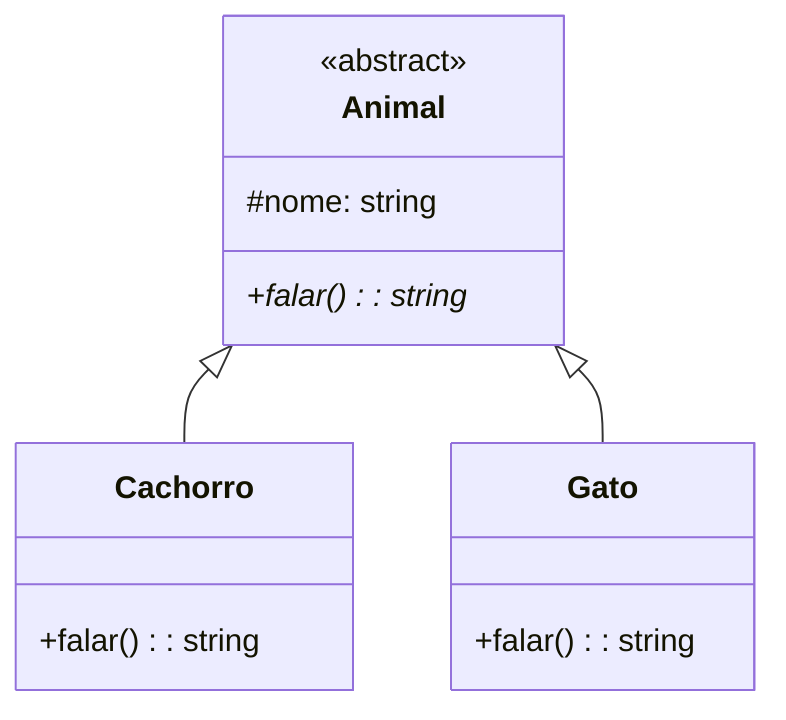

# Lista de Exercícios 5: Herança e Polimorfismo em TypeScript

## Parte 1: Herança Básica e Sobrescrita (`Override`)

### Questão 1: Hierarquia de Funcionários
Crie uma classe base `Funcionario` com os atributos protegidos `nome` e `salarioBase`, além de um método `calcularSalario(): number`. Em seguida, crie uma subclasse `Gerente` que herda de `Funcionario`, adiciona o atributo `bonus` e utiliza a palavra-chave `super` para sobrescrever (`override`) o cálculo do salário somando o bônus.

### Questão 2: Veículos e Aceleração
Modele uma classe `Veiculo` com o atributo `velocidade` e o método `acelerar(incremento: number)`. Crie uma subclasse `CarroEsportivo` que sobrescreve o método `acelerar()` para incrementar a velocidade no dobro da taxa informada, utilizando `super`.

### Questão 3: Sons de Animais (Polimorfismo de Sobreposição)
Crie uma classe abstrata `Animal` com o atributo protegido `nome` e o método abstrato `falar(): string`. Implemente duas subclasses concretas, `Cachorro` e `Gato`, que sobrescrevem o método `falar()` retornando sons específicos para cada animal.

### Questão 4: Contas Bancárias e Taxas
Defina uma classe `ContaBancaria` com saldo e um método `sacar(valor: number): boolean`. Crie uma subclasse `ContaCorrente` que reconstrói a lógica de saque debitando uma taxa fixa operacional a cada operação, utilizando `super`.

### Questão 5: Impressão de Documentos
Crie uma superclasse `Documento` com um método `imprimir(): void`. Crie subclasses `Relatorio` e `Certificado` que fazem o `override` desse método customizando a mensagem exibida.

---

## Parte 2: Sobrecarga de Métodos (`Overload`)

### Questão 6: Formatador de Dados Polimórfico
Implemente uma função utilitária `formatarDado` utilizando assinaturas de sobrecarga (`overload`) no TypeScript que aceite uma `string` (retornando-a em maiúsculo) ou um `number` (formatando com casas decimais).

### Questão 7: Calculadora Simples com Sobrecarga
Crie uma classe `CalculadoraSimples` contendo o método `somar` sobrecarregado para aceitar dois números, três números ou um array contendo múltiplos números.

### Questão 8: Construtor com Sobrecarga em Pessoas
Crie uma classe `Pessoa` que permita instanciar objetos apenas informando o `nome`, ou informando tanto o `nome` quanto a `idade`, simulando sobrecarga de construtor.

### Questão 9: Repositorio de Buscas Múltiplas
Implemente uma classe `Repositorio` com o método `buscar` sobrecarregado para receber um identificador numérico (retornando uma string descritiva) ou uma string de termo de busca (retornando um array de strings).

### Questão 10: Função de Concatenação Dinâmica
Crie uma função sobrecarregada `unir` que realize a concatenação de duas strings ou a operação matemática de soma caso os parâmetros recebidos sejam numéricos.

---

## Parte 3: Generalização, Downcasting e Polimorfismo de Inclusão

### Questão 11: Vetor Genérico de Formas Geométricas (Generalização)
Implemente uma classe abstrata `FiguraGeometrica` com um método abstrato `calcularArea(): number`. Crie subclasses concretas `Circulo` e `Retangulo`. Em seguida, crie um array generalizado do tipo `FiguraGeometrica[]` contendo instâncias mistas de ambas as formas.

### Questão 12: Downcasting Seguro com `instanceof`
Utilizando o vetor generalizado da Questão 11, percorra os elementos utilizando um laço e aplique o operador `instanceof` para realizar o *downcasting* e identificar o tipo específico de cada objeto no escopo.

### Questão 13: Hierarquia de Animais do IFPI
Crie uma classe base `AnimalBase` (com espécie) e subclasses `Bovino` e `Peixe`. Desenvolva uma função externa que receba um objeto do tipo genérico `AnimalBase` e processe suas características gerais.

### Questão 14: Sistema de Vendas de Carros
Com base nas atividades clássicas de vendas do IFPI, crie uma superclasse `VendaCarro` e subclasses especializadas (`Avista`, `Cartao` e `Boleto`), sobrescrevendo o método `calculaVenda()` de acordo com regras de desconto específicas para cada modalidade de pagamento.

### Questão 15: Auditoria de Elementos Tributáveis
Modele uma interface `Tributavel` com o método `calculaTributos(): number`. Crie classes como `ContaCorrente` e `SeguroDeVida` que realizam essa implementação. Desenvolva uma classe `AuditoriaInterna` capaz de acumular e calcular o somatório de tributos de forma totalmente polimórfica.

---

## Parte 4: Casos Avançados (F-Bounded Polymorphism e Encadeamento)

### Questão 16: Polimorfismo F-Bounded em Calculadoras Fluentes
Utilize o tipo polimórfico `this` em TypeScript para implementar uma interface fluente (`Fluent Interface`) em uma classe `CalculadoraFluente`, permitindo o encadeamento de métodos matemáticos.

### Questão 17: Extensão de Calculadora Científica
Estenda a `CalculadoraFluente` desenvolvida na questão anterior para criar uma `CalculadoraCientifica`, adicionando operações avançadas (como potenciação) sem perder a capacidade de encadeamento de métodos.

### Questão 18: Cadeia de Construtores Acadêmicos
Implemente uma classe base `PessoaRegistro` e uma subclasse `AlunoIFPI` que repassa dados cadastrais de forma segura via `super()`.

### Questão 19: Filtragem e Coerção em Lote
Crie um array misto contendo instâncias de `PessoaRegistro` e `AlunoIFPI`. Escreva um algoritmo de varredura que utilize `instanceof` para extrair e exibir apenas os dados acadêmicos dos alunos matriculados.

### Questão 20: Builder Pattern com Polimorfismo de Requisições
Implemente uma classe `RequisicaoHttp` com um método `enviar(dados: string)`. Crie uma subclasse `RequisicaoSegura` que sobrescreve o método aplicando regras de formatação/segurança e reutilizando o comportamento base via `super()`.

---
*Bom trabalho a todos! Desenvolva os códigos no seu ambiente de preferência e valide os testes.*